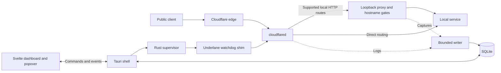

# Architecture

Underlane uses Tauri 2, a Rust core, and a Svelte 5 / TypeScript interface. It runs the
`cloudflared` binary rather than implementing the tunnel protocol. The core has no Tauri
dependency; the desktop shell handles macOS integration and connects it to the UI.

## Runtime

The supervisor launches each connector through the watchdog shim, follows JSON logs
and health endpoints, and restarts crashed tunnels with exponential backoff. The shim
kills the connector if the app dies; startup also reaps orphaned processes. Underlane
checks for the same tunnel running elsewhere to avoid splitting traffic across connectors.
Quitting the app stops its managed tunnels.

The menu bar uses `NSStatusItem`; its count is hidden when no tunnels are active.
The popover is created on demand. Closing the dashboard destroys its webview and frees
its WebContent process. Launch at login uses `SMAppService`.

## Code map

| Location | Responsibility |
| --- | --- |
| `crates/underlane-core/src/supervisor.rs`, `shim.rs`, `platform.rs` | Connector lifecycle, health, restarts, process cleanup |
| `crates/underlane-core/src/config.rs`, `derived.rs`, `import.rs` | Read configs, discover existing tunnels, prepare inspection routes |
| `crates/underlane-core/src/projects.rs`, `tunnel_setup.rs`, `hostnames.rs`, `dns.rs`, `separate_tunnel.rs`, `connection.rs` | Project drafts, tunnel setup, hostname edits, DNS, separate tunnel plans |
| `crates/underlane-core/src/proxy/`, `decode.rs` | Streaming capture, redaction, display-time body decoding |
| `crates/underlane-core/src/cli.rs`, `secret.rs`, `db.rs` | Bounded one-shot commands, secret handling, SQLite migrations and queries |
| `apps/desktop/src-tauri/src/` | Tauri commands, installer, onboarding, Keychain, native windows, state and storage tasks |
| `apps/desktop/src/` | Svelte dashboard and popover, Tailwind v4, shadcn-svelte components |
| `apps/web/` | Astro landing page and product screenshot fixtures |

## Projects and config ownership

A project represents one locally managed tunnel and its config. Groups organize projects
and tunnels independently of their config folders. New configs default to
`~/.cloudflared/underlane`; imported configs stay in their original location.

Importing, starting, and inspection read the source YAML. Underlane writes
a derived config under its app-data directory, replaces eligible service URLs with loopback
proxy addresses, and resolves file paths against the source directory. Unsupported rules
keep their original routes. A config project's proxy startup failure stops the connector
instead of bypassing hostname controls. Quick tunnels can still fall back to direct routing
with an inspection warning.

Explicit tunnel setup and hostname saves can update the source. They validate the candidate,
check for conflicting edits, and publish it with an exact backup of the original. Advanced
settings survive, though YAML comments and formatting may change. External edits show a
config-change notice; a restart applies them.

Hostname Start/Stop changes an app-owned selection and the live proxy gate, without editing
source YAML, replacing listeners, or restarting cloudflared while sibling hostnames are enabled.
Starting one hostname in a stopped project creates a selection containing only that rule.
Whole-project Start enables all rules;
Restart, crash recovery, and launch restoration preserve the saved selection. Stopped hostnames
return HTTP 503 with `Cache-Control: no-store`; requests and streams already in flight can finish
while the connector remains running. Stopping the last enabled hostname shuts down the connector
and clears project activity. An empty saved selection does not launch a connector automatically;
an explicit project Start enables all hostnames again.
Each rule is identified by hostname, path, and origin service, with run/config checks rejecting
stale actions. Selection saves complete before a gate opens.

Individual controls require a local config whose hostname rules use supported HTTP/HTTPS
origins and whose unnamed fallback rules return static HTTP statuses. Advanced origins,
unnamed origin routes, duplicate identical rules, and configs containing `token` or `token-file`
keep whole-project controls. Token authentication can replace local ingress with remote rules,
which bypass the local gates. Eligible
routes use the proxy even with inspection off, without recording requests.

Automatic DNS and connection checks cover only enabled hostnames on running projects. Stopped
rows keep their DNS actions but show a DNS result only after an explicit check of that row.
Inline DNS badges show missing or conflicting records. Unverified DNS status and its
explanation remain in the hostname's DNS actions menu, including for running hostnames.

Guided setup uses cloudflared's default `~/.cloudflared/cert.pem` account and saves new tunnel
credentials to `~/.cloudflared/underlane/<project-id>.json`. Login authorizes tunnel management;
visitor access policies are separate. Saved setup intent and credentials
allow retries after remote creation succeeds but local linking fails. Setup leaves the project
stopped so hostnames and DNS can be configured first.

Hostname diagnostics are owned by the desktop backend, so the dashboard and menu bar share
DNS, local TCP, and public HTTPS evidence even while the dashboard is closed. DNS checks reuse
the cloudflared login; an optional Zone Read / DNS Read token lives in the Keychain. Initial
checks, starts, changed configurations or authorization, and explicit **Check connection**
refresh evidence. While a connector is active, public/local checks run every 60 seconds and
DNS checks every five minutes, with bounded concurrency and failure backoff. Stopped projects
are checked once and on request. Run, child configuration revision, source and authorization
identity, and diagnostic generation prevent late results from restoring old evidence.

**Connected** means the connector reaches Cloudflare. **Public connection verified** also
requires authoritative DNS targeting that tunnel, an unchanged loaded config, a reachable local
port, and a recent successful uncached HTTPS check. Public DNS alone cannot reveal every proxied
CNAME target. Authentication gates, redirects, cached responses, root 404s, and unsupported
routes remain explicitly incomplete. A saved test path must match the intended ordered ingress
rule; ambiguous patterns and wildcard hostnames are not guessed. Checks make an unauthenticated
GET with a five-second timeout, a 64 KiB response cap, normal TLS verification, and no redirects.
Choose a side-effect-free test endpoint. Verification applies to the endpoint from this Mac;
it does not establish application flows such as Google sign-in.

Inline hostname warnings appear only when **Repair DNS** or **Create DNS record** is available;
other states keep compact hostname rows. A wrong-tunnel warning offers **Repair DNS**. Confirmation
pins the exact record, account, target, config and connector run for two minutes. Repair verifies
the destination tunnel, rereads the reviewed record, PATCHes only its CNAME content, and checks
Cloudflare's readback. The login's write authorization is required; the optional DNS-read token
is never used for writes. Changed, replaced, missing, non-tunnel, and ambiguous records require
fresh review. Creating a missing record remains a separate non-overwriting action. Repair never
edits YAML or starts/restarts the connector. Cloudflare has no atomic conditional DNS update,
leaving a narrow concurrent external-edit race between the final read and PATCH.

**Create separate tunnel** can give a project that shares a connector its own Cloudflare
tunnel and config, then update its DNS. The app retains recovery state for interrupted setup.

## Request inspection

Inspection supports quick tunnels and eligible HTTP/HTTPS or WebSocket services in local
configs. Token tunnels, Unix sockets, and rules using `http2Origin` or `matchSNItoHost` bypass
the proxy. The UI explains exclusions. Projects enable inspection by default; quick tunnels
require opting in. Capture can be paused per tunnel without stopping traffic.

The Hyper proxy forwards frames while copying bounded bodies. WebSocket frames pass through;
Underlane records metadata and byte counts. SSE streams pass through without storing response
bodies, though [Cloudflare quick tunnels do not support SSE](https://developers.cloudflare.com/tunnel/get-started/quick-tunnels/#limitations).
Gzip, Brotli, and deflate decoding happens when displaying captured bodies.

Sensitive headers and selected query parameters are redacted before storage, including URL
values in headers and diagnostics. Bodies are stored as sent, up to the configured limit
(default 1 MiB per body), and marked when truncated. Copy as curl uses the redacted values.
A 64 MiB in-flight body budget and a separate 64 MiB writer queue budget bound capture memory;
when storage falls behind, captures are dropped and counted so traffic can continue.

## Local data and secrets

On macOS, app data lives in `~/Library/Application Support/app.underlane/`.
`UNDERLANE_DATA_DIR` overrides it for tests and experiments.
Data from the previous `com.davidsonsns.underlane` bundle ID is not automatically moved.

| Path | Contents |
| --- | --- |
| `underlane.db` | Settings, groups, tunnels, logs, captured requests; current schema v3 |
| `derived/` | Generated inspection configs |
| `run/` | Connector pidfiles |
| `neutral.yml` | Prevents quick and token tunnels from loading a default config |
| `bin/cloudflared` | Optional app-managed connector, verified against an official release checksum |

SQLite migrations run transactionally and reject newer schemas before writing. Cleanup runs
at startup and periodically, expiring logs and requests after 7 days by default and pruning
oldest records to enforce the default 256 MiB size limit. Both limits are configurable.

Tunnel tokens live in the macOS Keychain and reach cloudflared through `TUNNEL_TOKEN`, never
command-line arguments. Account certificates and tunnel credential files remain in
`~/.cloudflared`. One-shot CLI operations have timeouts, cancellation, process cleanup, and
redacted diagnostics. App reset removes local app state and saved tunnel tokens while preserving
shared source configs, cloudflared authorization, and optional DNS API tokens.

The app currently targets macOS. Its sidebar checks published GitHub Releases for updates;
Tauri verifies signed update archives before users install and restart. Update restarts
restore the running projects from a one-shot session snapshot, leaving stopped projects
stopped regardless of autostart settings. Remote tunnel/DNS deletion and
Windows/Linux builds are outside its current scope.

For design rationale, see [decisions](docs/decisions.md) and [research](docs/research.md).
For build commands and checks, see [development](docs/development.md).
