<p align="center">
  
</p>

# Underlane

A free, open source macOS menu bar app for Cloudflare Tunnels, with a request inspector
for your local apps.

[Website and screenshots](https://underlane.app) · [Changelog](CHANGELOG.md) · [Troubleshooting](TROUBLESHOOTING.md) · [Architecture](ARCHITECTURE.md) · [Development](docs/development.md)

## Motivation

Cloudflare Tunnel provided a simple, reliable way to expose local apps on a custom
domain. What was missing was a clear view of the requests coming through and the
responses going back.

Underlane grew from that need for request inspection. The menu bar controls and other
features came from everyday use.

## What it does

- Inspect request and response headers, bodies, status, and timing. Read formatted JSON
  or a hex view, and copy requests as curl.
- Start and stop tunnels from the menu bar, recover from crashes, and bring tunnels
  back automatically at login.
- Organize projects into groups, load existing cloudflared configs, or share a local
  service through a temporary quick tunnel.
- Edit hostname rules with backups, check and create DNS records using your Cloudflare
  login, and spot config changes that need a restart.
- Search and filter tunnel logs, with failure explanations and suggested fixes.

## Setup

Requires macOS 13.3 or later. Download a published DMG from
[GitHub Releases](https://github.com/davidsonsns/underlane/releases), open it, and drag
Underlane into Applications. Each DMG supports Apple Silicon and Intel Macs.
If no release is listed yet, build from source below.

Downloaded builds are **ad-hoc signed and not notarized**. If macOS shows
**“Underlane” Not Opened**, follow the
[first-launch troubleshooting steps](TROUBLESHOOTING.md#macos-blocks-underlane-on-first-launch)
to approve the app.

### Build from source

You need macOS 13.3 or later, Xcode command-line
tools, Node.js 22.22+, pnpm 10.27.0, and [Rust](https://rustup.rs).

Enable the pinned pnpm version with Corepack (install Corepack first if your Node
distribution omits it), then build and install:

```sh
git clone https://github.com/davidsonsns/underlane.git
cd underlane
corepack enable
corepack install
make install
open ~/Applications/Underlane.app
```

`make install` builds the app and copies it to `~/Applications`, where launch at login
can use it. To build without installing, run `make build`; the bundle lands in
`target/release/bundle/macos/Underlane.app`.

### First launch

On first launch, Underlane finds your existing `cloudflared` or offers **Install for
Underlane**, which downloads a verified official release for Apple Silicon or Intel
without an administrator password. You can also install it with `brew install cloudflared`.

1. Choose **Use temporary link** and enter a local endpoint, such as
   `http://localhost:3000`, to try a quick tunnel without a Cloudflare account.
2. Open the dashboard and enable **Inspect requests** on the tunnel to see its traffic.
   Projects have inspection on by default; quick tunnels make it opt-in.

For your own domain, choose **Connect Cloudflare** during welcome, or **New → Project**
from the dashboard. Create a project, choose **Set up tunnel**, then configure its
hostnames and DNS before starting it. **New → Project** can also load an existing config.

## Before you use it

- Quitting Underlane stops its tunnels. Launch at login and **Start automatically**
  bring them back when you sign in.
- Quick links are public, change on every start, and are meant for testing and
  development. They do not support server-sent events ([Cloudflare's limits](https://developers.cloudflare.com/tunnel/get-started/quick-tunnels/#limitations)).
- Existing token tunnels can run, but do not support inspection. Unix sockets and
  some advanced config rules also bypass inspection; see [architecture](ARCHITECTURE.md#request-inspection).
- Captures stay in a local SQLite database. Underlane redacts sensitive headers and
  selected query parameters, but stores bodies as sent, up to the capture limit.
  Retention and size limits are configurable.
- Loading, starting, and inspecting leave your source config untouched. Tunnel setup
  and hostname saves update it with a backup; YAML comments and formatting may change.

Underlane runs the `cloudflared` binary and is not affiliated with Cloudflare.
For bugs or feature requests, [open an issue](https://github.com/davidsonsns/underlane/issues).
